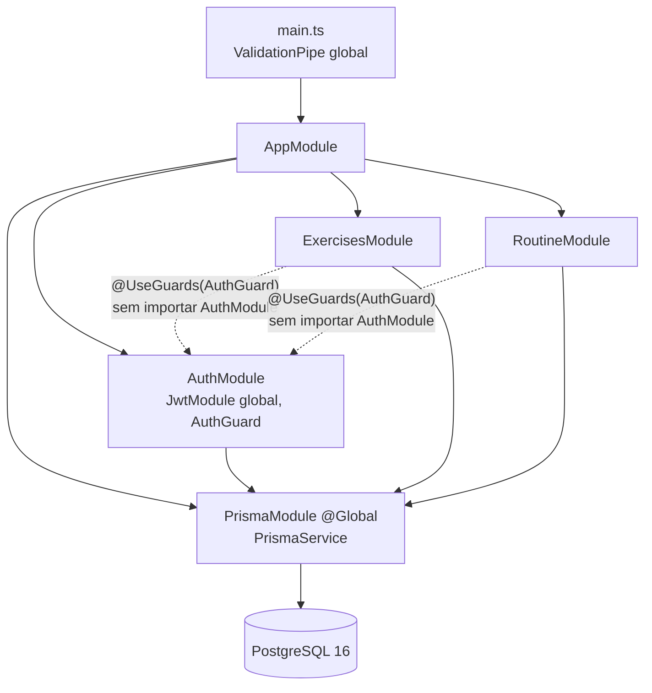
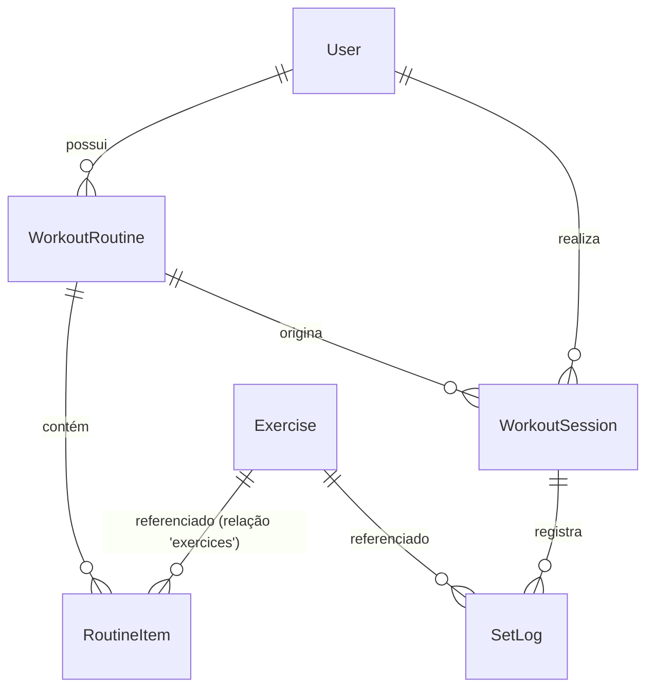

# Arquitetura — exactafit-api

> Mapeado a partir do código da versão da `main` de 2026-10-12. O que o código não responde está marcado `TODO(humano)`.

## Visão geral
API REST monolítica em NestJS 11. Cada domínio é um módulo Nest (controller → service → Prisma). Persistência em PostgreSQL 16 via Prisma 7 com `@prisma/adapter-pg`. Autenticação por JWT Bearer com validade de 7 dias. Não há camada de repositório, filtros de exceção, interceptors nem middlewares próprios.

### Pontos de entrada
| Entrada | Arquivo | Observação |
|---|---|---|
| Servidor HTTP | `src/main.ts` → `bootstrap()` | Porta `PORT` ou 3000. `ValidationPipe` global com `whitelist`, `forbidNonWhitelisted` e `transform`. Sem CORS, prefixo global, versionamento nem Swagger. |
| Módulo raiz | `src/app.module.ts` | Importa `PrismaModule`, `ExercisesModule`, `AuthModule` e `RoutineModule`. |
| Prisma CLI | `prisma.config.ts` | Schema `prisma/schema.prisma`, migrations em `prisma/migrations`, `DATABASE_URL`. |
| Testes e2e | `test/*.e2e-spec.ts` | Sobem `AppModule` inteiro e **registram de novo** o `ValidationPipe`, porque `main.ts` não roda nos testes. |

### Rotas
| Método e rota | Auth | Controller → Service |
|---|---|---|
| `GET /` | não | `AppController.getHello` → `AppService.getHello` |
| `POST /auth/register` | não | `AuthController.create` → `AuthService.create` |
| `POST /auth/login` | não | `AuthController.login` → `AuthService.login` |
| `POST /exercises` | sim | `ExercisesController.create` → `ExercisesService.create` |
| `GET /exercises` | sim | `ExercisesController.list` → `ExercisesService.list` |
| `POST /routine` | sim | `RoutineController.create` → `RoutineService.create` |
| `GET /routine` | sim | `RoutineController.findAll` → `RoutineService.findAll` |
| `GET /routine/:id` | sim | `RoutineController.findOne` → `RoutineService.findOne` |
| `PUT /routine/:id` | sim | `RoutineController.update` → `RoutineService.update` |

### Fluxo de dados
`HTTP → AuthGuard (rotas protegidas) → ValidationPipe (DTO) → Controller → Service → PrismaService → Postgres`. O `userId` sai de `request.user.sub`, que o `AuthGuard` preenche com o payload do JWT. As respostas são as entidades do Prisma serializadas direto, sem DTO de saída. A única exceção é o `password`, removido à mão no cadastro.

## Módulos

**`prisma`** (`src/prisma/`): expõe `PrismaService`, que estende `PrismaClient` com o adapter `PrismaPg` lendo `DATABASE_URL` e conecta em `onModuleInit`. É `@Global`, então qualquer módulo injeta o serviço sem importar o módulo. Não contém regra de negócio, repositórios nem `enableShutdownHooks`/`$disconnect`. Depende de `@prisma/client`, `@prisma/adapter-pg` e `dotenv/config`.

**`auth`** (`src/auth/`): cadastro (`AuthService.create`: e-mail único, bcrypt com custo 10, retorna o usuário sem `password`) e login (`AuthService.login`: compara o hash e assina um JWT `{ sub, email }`). Registra o `JwtModule` como **global**, com `JWT_SECRET` ou um segredo fixo de fallback, e exporta o `AuthGuard`, que extrai o `Bearer`, verifica com `process.env.JWT_SECRET` e grava o payload em `request.user`. Não faz refresh token, logout/revogação, recuperação ou troca de senha, papéis, rate limit nem normalização de e-mail. Depende de `prisma`, `@nestjs/jwt`, `bcrypt` e `dotenv/config`.

**`exercises`** (`src/exercises/`): catálogo de exercícios com criação e listagem completa. O catálogo é **global**: `Exercise` não tem `userId` e qualquer usuário autenticado cria itens visíveis para todos. Não edita, não remove, não filtra, não pagina e não impede nomes duplicados. Depende de `prisma` e do `AuthGuard`. A dependência do guard é implícita: o módulo não importa `AuthModule` e funciona porque o `JwtModule` é global.

**`routines`** (`src/routines/`): fichas de treino (`WorkoutRoutine`) com itens (`RoutineItem`) do usuário logado: criar, listar, detalhar e atualizar. Itens vêm ordenados por `order` na leitura. O `PUT` com `items` apaga e recria todos os itens numa `$transaction`. As leituras filtram por `userId`. Não tem `DELETE`, não valida se o `exerciseId` existe (a FK rejeita), não valida faixas de `targetSets`/`targetReps`/`order` e não impede exercício repetido. Depende de `prisma` e do `AuthGuard`, também de forma implícita. A interface `AuthenticatedRequest` está declarada em `routine.controller.ts`.

**`app`** (`src/app.*`): boilerplate do Nest (`GET /` → `"Hello World!"`), sem autenticação. `TODO(humano)`: manter como health check ou remover?

**`sessions`**: não existe na `main`. O schema (`WorkoutSession`, `SetLog`) e a migration `20260822181835` já estão na `main`, mas nenhum código usa esses modelos. O módulo está em andamento na branch `wip/sessions` (commit `e7300a8`) e não foi mapeado aqui. `TODO(humano)`: documentar quando for integrado.

## Modelo de dados (`prisma/schema.prisma`)

| Modelo (tabela) | Campos de negócio | Observação |
|---|---|---|
| `User` (`users`) | `name` varchar(100), `email` varchar(255) único, `password` varchar(255) (hash) | |
| `Exercise` (`exercises`) | `name`, `muscleGroup`, `type` (default `"strength"`) | `TEXT` sem limite no banco; o DTO limita a 100. Sem dono. |
| `WorkoutRoutine` (`workout_routines`) | `userId`, `name` varchar(100), `description?` varchar(255) | |
| `RoutineItem` (`routine_items`) | `routineId`, `exerciseId`, `order`, `targetSets`, `targetReps` | A relação com `Exercise` se chama `exercices` (grafia). |
| `WorkoutSession` (`workout_sessions`) | `userId`, `routineId`, `startedAt` | Sem `finishedAt`, `createdAt` ou `updatedAt`. |
| `SetLog` (`set_logs`) | `sessionId`, `exerciseId`, `setNumber`, `weightKg` (Float), `repsCompleted`, `failed` (default `false`) | Sem unicidade por (sessão, exercício, série). |

Todas as FKs usam `ON DELETE CASCADE`. Ids são UUID em `TEXT`. Não há índices nas colunas de FK.

## Fluxos ponta a ponta

### 1. Cadastro de usuário (`POST /auth/register`)
1. `src/main.ts` `bootstrap()`: o `ValidationPipe` valida o body contra `RegisterUserDto` (`src/auth/dto/register.dto.ts`): `name` 1–100, `email` válido ≤255, `password` 6–72 (comportamento atual; decidido em U3: ver `docs/domain.md`). Campo extra → 400.
2. `src/auth/auth.controller.ts` `AuthController.create(dto)` → delega.
3. `src/auth/auth.service.ts` `AuthService.create`: `prisma.user.findUnique({ email })`. Se existir → `ConflictException` (409).
4. Mesmo método: `bcrypt.hash(password, 10)` → `prisma.user.create`.
5. Remove `password` do objeto e retorna 201 com `id, name, email, createdAt, updatedAt`.
- Coberto por `test/auth.e2e-spec.ts` (sucesso e duplicado).

### 2. Login e acesso autenticado (`POST /auth/login` → `GET /routine/:id`)
1. `LoginUserDto` (`src/auth/dto/login.dto.ts`) valida `email` e `password` (6–72; comportamento atual; decidido em U3: ver `docs/domain.md`).
2. `AuthController.login` → `AuthService.login`: `findUnique({ email })`. Usuário inexistente ou senha errada (`bcrypt.compare`) → 401 `"Credenciais inválidas"`.
3. `jwtService.signAsync({ sub: user.id, email })` com o segredo e o `expiresIn: '7d'` de `src/auth/auth.module.ts`. Retorna 201 `{ accessToken }`.
4. Na requisição seguinte, `src/auth/auth.guard.ts` `AuthGuard.canActivate` → `extractTokenFromHeader` (`Bearer <token>`) → `verifyAsync(token, { secret: process.env.JWT_SECRET })` → `request.user = payload`. Qualquer falha → 401 `"Token inválido"`.
5. `src/routines/routine.controller.ts` `RoutineController.findOne`: `ParseUUIDPipe` no `:id` (400 se não for UUID) e `userId = req.user.sub`.
6. `src/routines/routine.service.ts` `RoutineService.findOne`: `workoutRoutine.findFirst({ id, userId })` com `routineItems` + `exercices` ordenados por `order`. Se não achar (inexistente ou de outro usuário) → 404 `"Ficha de treino não encontrada"`.
- Coberto por `test/auth.e2e-spec.ts` e `test/routines.e2e-spec.ts` (o teste de `GET /routine/:id` não confere o status, e não há teste de acesso a ficha de outro usuário).

### 3. Atualização de ficha (`PUT /routine/:id`)
1. `AuthGuard` (como no fluxo 2) e `ParseUUIDPipe`.
2. `UpdateRoutineDto` (`src/routines/dto/update-routine.dto.ts`) = `PartialType(CreateRoutineDto)`: todos os campos opcionais. Se `items` vier, cada item é validado por `CreateRoutineItemDto` (`exerciseId` UUID; `order`, `targetSets` e `targetReps` inteiros).
3. `RoutineController.update` → `RoutineService.update(userId, id, dto)`.
4. `RoutineService.update` chama `this.findOne(userId, id)` para checar a posse (404 se não for dono). Essa checagem roda **fora** da transação.
5. `prisma.$transaction`: se `dto.items` existir, `routineItem.deleteMany({ routineId: id })`. Depois `workoutRoutine.update({ where: { id } })` com `name`/`description` e `routineItems.create` dos novos itens. Os ids dos itens mudam a cada update.
6. Retorna 200 com a ficha e os itens (com `exercices`) ordenados.
- Coberto por `test/routines.e2e-spec.ts` (apenas o caminho feliz).

## Zonas de risco e dívidas

### Código sem teste
- Teste unitário (`src/**/*.spec.ts`): só `src/app.controller.spec.ts`, do boilerplate. Nenhum service ou guard tem teste unitário.
- Testes e2e (`test/`, exigem Postgres): `app.e2e-spec.ts`, `auth.e2e-spec.ts`, `routines.e2e-spec.ts` e os de caracterização `authguard-caracterizacao.e2e-spec.ts`, `exercises-caracterizacao.e2e-spec.ts` e `routines-caracterizacao.e2e-spec.ts`.
- Caracterização (cobre `AuthGuard`, `exercises` e `routines`: 401, validação, posse, itens e ordenação). As divergências de `domain.md` travadas por teste, em `describe('comportamento atual (diverge de domain.md)')`, que quebram de propósito quando a regra for implementada:
  - `AuthGuard`: C1 (token de usuário inexistente ou removido continua aceito, 200).
  - `exercises`: E1/E2 (exercício sem dono, visível a todos), E4 (`muscleGroup` texto livre) e E4 (`type` aceito no POST).
  - `routines`: F4 (faixas e `order` zero ou negativo), F11 (`order` repetido), F10 (51 itens e mais de 10 fichas), F6 (`exerciseId` inexistente dá 500; também com exercício de outro usuário, F6/E1) e caso 1 (`PUT` com `name: null` dá 500).
- Ainda sem teste: services e guard em nível unitário; `AuthService` (cadastro e login) só tem o e2e `auth.e2e-spec.ts`.
- Os e2e antigos (`auth.e2e-spec.ts`, `routines.e2e-spec.ts`) não limpam os dados que criam; os de caracterização removem usuários e exercícios no `afterAll`.

### Duplicação
- O bloco `include: { routineItems: { include: { exercices: true }, orderBy: { order: 'asc' } } }` aparece 3× em `routine.service.ts` (`findAll`, `findOne`, `update`).
- O `map` de `items` → `RoutineItem` aparece 2× (`create`, `update`).
- A configuração do `ValidationPipe` aparece em `src/main.ts` e é copiada nos e2e. Se mudar em um lugar, os testes deixam de refletir a produção.
- `import 'dotenv/config'` aparece em 3 arquivos (`auth.module.ts`, `auth.guard.ts`, `prisma.service.ts`).
- A forma do payload JWT é declarada 2× (`JwtPayload` no guard e `AuthenticatedRequest` no controller de rotinas).

### Acoplamento
- `exercises` e `routines` usam `AuthGuard` sem importar `AuthModule`. Funcionam só porque `JwtModule` é `global: true`.
- O segredo JWT tem duas fontes: o módulo usa `JWT_SECRET || '<fallback fixo>'` e o guard passa `process.env.JWT_SECRET`. Sem a env, o guard passa `undefined` e o `@nestjs/jwt` cai no fallback, que está público no repositório (`src/auth/auth.module.ts:14`).
- `dotenv` é importado em runtime e já é dependência direta (`package.json:35`, PR #5). Deploy no V1: VPS própria ([domain.md U8](domain.md#usuários-e-acesso)).
- `RoutineItem` → `Exercise` com cascade: apagar um exercício do catálogo global apagaria itens de fichas e `SetLog` de **todos** os usuários. Hoje nenhuma rota apaga exercícios.
- `WorkoutRoutine` → `WorkoutSession` → `SetLog` com cascade: apagar uma ficha apagaria o histórico de sessões. Hoje nenhuma rota apaga fichas.

### Validação e autenticação dos endpoints
- `GET /` é público. É intencional se for health check.
- `POST /exercises`: qualquer usuário autenticado escreve no catálogo global.
- `POST/PUT /routine`: `items` aceita lista vazia. `order`, `targetSets` e `targetReps` aceitam zero e negativos. `exerciseId` inexistente gera erro de FK do Prisma, que não é tratado e provavelmente vira 500. Itens com `order` ou exercício repetido são aceitos.
- `PUT /routine/:id`: o `PartialType` torna os campos `@IsOptional`, que aceita `null`. Um `name: null` passaria pela validação e falharia no Prisma (coluna `NOT NULL`). Não verificado em execução.
- `PUT /routine/:id`: `deleteMany` e `update` filtram só por `id`/`routineId`, não por `userId`. A posse é garantida pelo `findOne` anterior, fora da transação. Isso foge da convenção "toda query filtra por `userId`".
- `POST /auth/register`: a corrida entre `findUnique` e `create` resulta em violação de unicidade não tratada (500 em vez de 409). O e-mail não é normalizado (maiúsculas/minúsculas).
- `POST /auth/login`: sem limite de tentativas. Senha com menos de 6 caracteres retorna 400, não 401.
- Não há filtro global para erros do Prisma (`P2002`, `P2003`, `P2025`).

### Migrations
- `20260818145558_rename_exercise_table` e `20260819144834_create_routines_and_routine_items_tables` fazem `DROP TABLE` + `CREATE` para renomear tabelas (`exercicios` → `exercices` → `exercises`). Aplicadas sobre um banco com dados, essas migrations apagam os dados. `TODO(humano)`: já existe algum ambiente com dados?
- `20260820002725_add_varchar_limits` converte `TEXT` → `VARCHAR`. Falha se houver valor maior que o limite.
- `exercises` ficou sem limites `VARCHAR`, diferente das outras tabelas.
- Nenhuma migration cria índice nas FKs (`user_id`, `routine_id`, `exercise_id`, `session_id`).
- `weight_kg` é `DOUBLE PRECISION` (ponto flutuante) para carga.

### Outros
- O CI roda `npm run typecheck` (`.github/workflows/ci.yml:45`). O passo de lint usa `npm run lint`, que tem `--fix`: o CI corrige em vez de falhar em problemas auto-corrigíveis.
- O CI tem `JWT_SECRET` e a senha do Postgres de teste em texto puro no `ci.yml`.
- `tsconfig.json` com `noImplicitAny: false`.
- `README.md` é o boilerplate do Nest.
- Branch `wip/sessions`: tem 42 erros de lint e 2 suítes unitárias falhando (ver `AGENTS.md`).

## Contrato OpenAPI
**Não existe.** `@nestjs/swagger` não está nas dependências e o `main.ts` não monta documento algum. Não há arquivo `openapi.*` no repositório.

Proposta (não implementada; exige aprovação de dependência nova):
1. Adicionar `@nestjs/swagger`.
2. Em `main.ts`, usar `DocumentBuilder` (título, versão, `addBearerAuth()`) + `SwaggerModule.createDocument` + `SwaggerModule.setup('docs', ...)`.
3. Ativar o plugin do CLI em `nest-cli.json` (`"plugins": [{ "name": "@nestjs/swagger", "options": { "classValidatorShim": true } }]`), que infere os schemas a partir dos DTOs e do `class-validator` sem decorators manuais.
4. Marcar as rotas protegidas com `@ApiBearerAuth()`. Para tipar as respostas, criar DTOs de saída (hoje as respostas são entidades Prisma).
5. Opcional: gerar um `openapi.json` versionado e comparar no CI para detectar quebra de contrato.

## Perguntas respondidas
As 10 perguntas do mapeamento foram respondidas em 2026-10-12 e viraram regras em `docs/domain.md`:
- Catálogo: [E1, E2](domain.md#exercícios) e [ADR 0003](adr/0003-catalogo-oficial-e-exercicios-do-usuario.md).
- Exclusão: [E6](domain.md#exercícios), [F9](domain.md#fichas-de-treino), [C2, C3](domain.md#exclusão-ver-adr-0001) e [ADR 0001](adr/0001-exclusao-sem-cascata-de-historico.md).
- Faixas e ficha vazia: [F3, F4, F11](domain.md#fichas-de-treino) e [S4](domain.md#sessões-e-séries-só-schema-nenhum-código-usa-ainda).
- Exercício repetido na ficha: [F5](domain.md#fichas-de-treino).
- `PUT` parcial e ids novos: [F8](domain.md#fichas-de-treino).
- Sessão aberta: [S2, S3](domain.md#sessões-e-séries-só-schema-nenhum-código-usa-ainda).
- `type`/`muscleGroup` e série falhada: [E4](domain.md#exercícios), [S6](domain.md#sessões-e-séries-só-schema-nenhum-código-usa-ainda) e [ADR 0002](adr/0002-definicao-de-serie-falhada.md).
- Carga: [S7](domain.md#sessões-e-séries-só-schema-nenhum-código-usa-ainda).
- E-mail e senha: [U1, U3](domain.md#usuários-e-acesso).
- `dotenv` e `JWT_SECRET`: [U8](domain.md#usuários-e-acesso).

O que ficou sem resposta nessas decisões:
- Expiração do token e refresh: adiado para a fase do front ([U6](domain.md#usuários-e-acesso)).
- Forma de deploy: VPS própria gerenciada com Coolify (decisão registrada em [U8](domain.md#usuários-e-acesso)). `TODO(humano)`: se a instalação em produção usa `npm ci --omit=dev`.
- As demais lacunas estão marcadas `TODO(humano)` em `docs/domain.md`.

## Decisões de produto
Antes pendentes, decididas em 2026-10-12 (regras em [`domain.md`](domain.md#decisões-de-produto-antes-pendentes)):
- Uso offline e sincronização: [ADR 0004](adr/0004-uso-offline-e-sincronizacao.md).
- Dataset de exercícios: [ADR 0005](adr/0005-carga-do-dataset-de-exercicios.md).
- Alimentação: fora do V1; não há ADR, a decisão está em [`domain.md` (c)](domain.md#c-alimentação--decidido).
